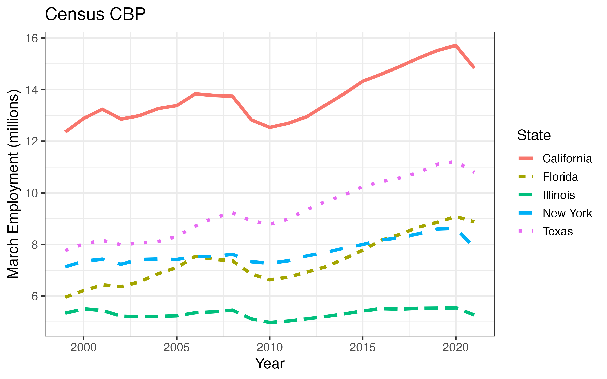

```{r setup, include=FALSE}
knitr::opts_chunk$set(echo = TRUE)
```

```{r echo=F, eval=T, warning=FALSE, comment=FALSE, warning=FALSE}
library(data.table)
library(ggplot2)
library(scales)
library(knitr)
```


[Prepared Census CBP data sets are located here.](https://github.com/setzler/EconData/tree/master/DataRepo/CensusCBP/)


### Download and clean the Census CBP


Census County Business Patterns (CBP) data is managed by the `getCBP()` function. The arguments are:

- `years`: years of CBP data to download (integer vector). Supported year range is 1999 to 2021.
- `location`: Can be `"county"`, `"state"`, or `"national"` (character).
- `industry`: Number of digits used in the NAICS code. `0` indicates use all industries.
- `LFO`: Choose a legal form of organization (LFO). Options include `'C'` for C-corporations, `'S'` for S-corporations, `'P'` for partnerships. Default is `'-'`, which means to use all LFO types.

The resulting data set includes the variables `year, employment_march, payroll_quarter1, establishments` as well as fips codes and industry codes corresponding to the `aggregation` choice.


### Demonstration

Here, we provide the core functions that download and clean the CBP files during 1999 - 2021. 

```{r echo=T, eval=F}
library(EconData)

# download CBP county employment files
downloadCBP(years = 1999:2021, location = "county", 
            input_path = "~/github/EconData/DataRepo/CensusCBP/raw")

# clean CBP county employment files
getCBP(years = 1999:2021, location = "county", industry = 0,  
       input_path = "~/github/EconData/DataRepo/CensusCBP/raw", 
       output_path = "~/github/EconData/DataRepo/CensusCBP") 

```

These steps are performed for all relevant combinations of locations and industries by running `inst/runCBP.R`. Furthermore, `inst/runCBP.R` prepares the cleanly labeled final version of each dataset by level of aggregation.

Let's plot the resulting data for the 5 most populous states:

```{r echo=T, eval=T}

CBP <- setDT(read.csv(file="~/github/EconData/DataRepo/CensusCBP/CBP_state_total.csv"))
kable(CBP[order(year,state_name)][1:5])

gg <- ggplot(aes(x=year,y=employment_march/1e6,color=state_name,linetype=state_name),data=CBP[state_name %in% c('California','Florida','Illinois','New York','Texas')]) + 
  geom_line(size = 1.5) +
  theme_bw(base_size=14) + 
  labs(x="Year", y="March Employment (millions)",title="Census CBP",color="State",linetype="State") +
  scale_x_continuous(breaks= c(2000,2005,2010,2015,2020), limits=c(1999,2021)) +
  scale_y_continuous(breaks= pretty_breaks())
ggsave(gg,file='CBP_state_employment.png',width=8,height=5)

```



